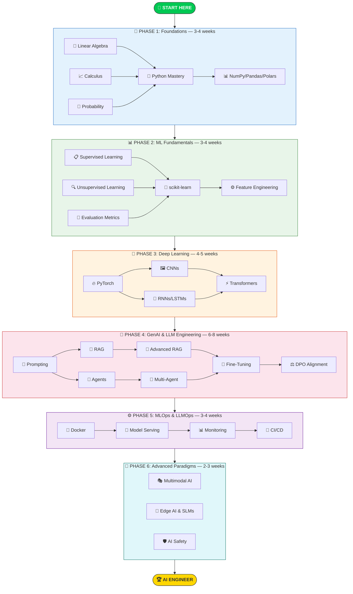

<div align="center">

# 🗺️ The 2026 AI Engineer Roadmap

**A structured, phase-by-phase learning path from absolute beginner to production AI Engineer.**

*Estimated Total Duration: 22–28 weeks (5–7 months) at 15–20 hours/week*

</div>

---

## How to Use This Roadmap

1. **Follow the phases in order** — each phase builds on the previous one
2. **Complete the notebooks** before moving to the next phase
3. **Build at least one project** from Phases 4–6 for your portfolio
4. **Check off completed items** to track your progress
5. **Don't rush** — deep understanding beats surface-level coverage

### Difficulty Legend

| Symbol | Level | Description |
|:------:|-------|-------------|
| 🟢 | Beginner | No prior knowledge required |
| 🟡 | Intermediate | Requires foundational understanding |
| 🟠 | Advanced | Requires solid intermediate skills |
| 🔴 | Expert | Production-level, cutting-edge topics |

---

## Visual Learning Path



---

## Phase 1: The Foundations 📐

> **Duration**: 3–4 weeks · **Difficulty**: 🟢 Beginner · **Prerequisites**: None

Before interacting with neural networks, a solid foundation in mathematics and programming is non-negotiable.

### Mathematics for AI

You don't need a PhD in mathematics — but understanding the underlying mechanics is crucial for debugging and optimization.

- [x] **Linear Algebra** 🟢
  - Vectors, Matrices, Tensors
  - Matrix Multiplication & Dot Products
  - Eigenvectors & Eigenvalues
  - *Why it matters: This is how weights and embeddings work*
  - 📓 [`01-linear-algebra-for-ai.ipynb`](notebooks/01-foundations/01-linear-algebra-for-ai.ipynb)

- [x] **Calculus & Optimization** 🟢
  - Derivatives & Partial Derivatives
  - The Chain Rule
  - Gradients & Gradient Descent
  - *Why it matters: The engine behind backpropagation*
  - 📓 [`02-calculus-and-optimization.ipynb`](notebooks/01-foundations/02-calculus-and-optimization.ipynb)

- [x] **Probability & Statistics** 🟢
  - Distributions: Normal, Poisson, Binomial
  - Bayes' Theorem
  - Variance, Standard Deviation, Covariance
  - *Why it matters: Understanding model confidence, temperature, and sampling*
  - 📓 [`03-probability-statistics.ipynb`](notebooks/01-foundations/03-probability-statistics.ipynb)

### Programming Core

Python remains the undisputed king of AI. In 2026, proficiency goes beyond basic syntax — it requires writing efficient, asynchronous, and typed code.

- [x] **Python Mastery** 🟢
  - List comprehensions, generators, decorators
  - `asyncio` (crucial for parallel API calls in agentic workflows)
  - Type hinting with `typing` module
  - Context managers and error handling
  - 📓 [`04-python-mastery.ipynb`](notebooks/01-foundations/04-python-mastery.ipynb)

- [x] **NumPy Essentials** 🟢
  - N-dimensional arrays
  - Broadcasting and vectorized operations
  - Linear algebra with NumPy
  - 📓 [`05-numpy-essentials.ipynb`](notebooks/01-foundations/05-numpy-essentials.ipynb)

- [x] **Pandas & Polars** 🟢
  - DataFrames: loading, filtering, grouping, joining
  - Polars for high-performance data processing
  - Real-world data cleaning workflows
  - 📓 [`06-pandas-polars-data.ipynb`](notebooks/01-foundations/06-pandas-polars-data.ipynb)

- [x] **Git & Dev Tools** 🟢
  - Git workflows: branching, merging, rebasing
  - GitHub: issues, PRs, Actions
  - Linux bash scripting basics
  - 📓 [`07-git-and-dev-tools.ipynb`](notebooks/01-foundations/07-git-and-dev-tools.ipynb)

### Phase 1 Capstone & Custom Projects

- [x] **Phase 1 Capstone Project** 🟢
  - End-to-end telemetry analytics, SVD/PCA anomaly detector, scratch Adam risk classifier, Bayesian posterior tracking, and SHA-256 artifact manifests
  - 📓 [`08-phase-1-capstone-project.ipynb`](notebooks/01-foundations/08-phase-1-capstone-project.ipynb)

- [x] **Phase 1 Custom Projects Guide** 🟢
  - 4 custom project blueprints (`MicroGrad-Matrix`, `AsyncPulse`, `LatentSearch`, `DataGuard-CLI`), 5-milestone roadmaps, runnable starters & rubric evaluator
  - 📓 [`09-phase-1-custom-projects-guide.ipynb`](notebooks/01-foundations/09-phase-1-custom-projects-guide.ipynb)

### ✅ Phase 1 Completion Checklist

When you can do all of the following, you're ready for Phase 2:

- [x] Explain what a matrix multiplication does and why it's central to neural networks
- [x] Compute a gradient by hand for a simple function
- [x] Write a Python async function that makes concurrent HTTP requests
- [x] Load, clean, and visualize a dataset with Pandas and Polars
- [x] Create a Git branch, make commits, and open a pull request

---

## Phase 2: ML Fundamentals 📊

> **Duration**: 3–4 weeks · **Difficulty**: 🟡 Intermediate · **Prerequisites**: Phase 1

Foundation models are powerful, but traditional ML is still cheaper and better for structured tabular data. You must understand traditional ML before jumping into Deep Learning.

### Core Concepts

- [x] **Supervised Learning** 🟡
  - Linear Regression & Logistic Regression
  - Decision Trees & Random Forests
  - Gradient Boosting: XGBoost, LightGBM
  - *When to use: Structured/tabular data, classification, regression*
  - 📓 [`01-supervised-learning.ipynb`](notebooks/02-ml-fundamentals/01-supervised-learning.ipynb)

- [x] **Unsupervised Learning** 🟡
  - K-Means Clustering
  - PCA (Principal Component Analysis)
  - t-SNE for embedding visualization
  - *When to use: Clustering, dimensionality reduction, data exploration*
  - 📓 [`02-unsupervised-learning.ipynb`](notebooks/02-ml-fundamentals/02-unsupervised-learning.ipynb)

- [x] **Evaluation Metrics** 🟡
  - Classification: Accuracy, Precision, Recall, F1-Score, ROC-AUC
  - Regression: MSE, RMSE, MAE, R²
  - Knowing which metric to use for which problem
  - 📓 [`03-evaluation-metrics.ipynb`](notebooks/02-ml-fundamentals/03-evaluation-metrics.ipynb)

### The Workflow

- [x] **scikit-learn End-to-End** 🟡
  - Pipelines: preprocess → train → evaluate → serialize
  - Cross-validation strategies
  - Model selection and comparison
  - 📓 [`04-scikit-learn-workflow.ipynb`](notebooks/02-ml-fundamentals/04-scikit-learn-workflow.ipynb)

- [x] **Feature Engineering** 🟡
  - Handling missing data (imputation strategies)
  - Encoding categorical variables (OneHot, Ordinal, Target)
  - Feature scaling (StandardScaler, MinMaxScaler, RobustScaler)
  - Feature selection (mutual information, recursive elimination)
  - 📓 [`05-feature-engineering.ipynb`](notebooks/02-ml-fundamentals/05-feature-engineering.ipynb)

- [x] **Hyperparameter Tuning** 🟡
  - Grid Search & Random Search
  - Bayesian Optimization with Optuna
  - Cross-validation + tuning best practices
  - 📓 [`06-hyperparameter-tuning.ipynb`](notebooks/02-ml-fundamentals/06-hyperparameter-tuning.ipynb)

### Capstone & Custom Projects

- [x] **Phase 2 Capstone Project** 🏆
  - End-to-end Customer Churn & LTV ML System combining every Phase 2 concept with beginner-friendly analogies, leakage-free pipelines, Optuna tuning, cost-optimal thresholds, and 3 multi-panel visuals
  - 📓 [`07-phase-2-capstone-project.ipynb`](notebooks/02-ml-fundamentals/07-phase-2-capstone-project.ipynb)

- [x] **Phase 2 Custom Projects Guide** 🛠️
  - 4 custom ML project blueprints (`HeartGuard`, `HomeValue-AI`, `ShopPersona`, `LeakageBuster`) with starter code, step-by-step roadmaps, 2 visual guides, and portfolio rubric
  - 📓 [`08-phase-2-custom-projects-guide.ipynb`](notebooks/02-ml-fundamentals/08-phase-2-custom-projects-guide.ipynb)

### ✅ Phase 2 Completion Checklist

- [x] Train an XGBoost model that beats a logistic regression baseline on a real dataset
- [x] Explain the bias-variance tradeoff and demonstrate it with learning curves
- [x] Build a complete scikit-learn pipeline with preprocessing, training, and evaluation
- [x] Use Optuna to find optimal hyperparameters with cross-validation
- [x] Correctly choose between accuracy, F1, and ROC-AUC for a given problem

---

## Phase 3: Deep Learning & Neural Networks 🧠

> **Duration**: 4–5 weeks · **Difficulty**: 🟠 Advanced · **Prerequisites**: Phases 1–2

This phase introduces representation learning, where AI extracts features automatically. In 2026, **PyTorch** and **JAX** are the dominant frameworks. TensorFlow is largely legacy except in specific enterprise pipelines.

### The Deep Learning Stack

- [x] **PyTorch & TensorFlow Fundamentals** 🟡
  - PyTorch: Tensors, dynamic Autograd graphs, `nn.Module`, `DataLoader`
  - TensorFlow: `tf.GradientTape`, `@tf.function` XLA graphs, Keras 3 APIs, `tf.data`
  - 📓 [`01-pytorch-fundamentals.ipynb`](notebooks/03-deep-learning/01-pytorch-fundamentals.ipynb) · [`02-tensorflow-fundamentals.ipynb`](notebooks/03-deep-learning/02-tensorflow-fundamentals.ipynb)

- [x] **Neural Networks from Scratch** 🟠
  - Multi-Layer Perceptrons (MLPs) in pure NumPy
  - Activation functions, Cross-Entropy, manual matrix-calculus backpropagation
  - Dual gradient verification against PyTorch & TensorFlow
  - 📓 [`03-neural-networks-from-scratch.ipynb`](notebooks/03-deep-learning/03-neural-networks-from-scratch.ipynb)

### Architectures You Must Know

- [x] **CNNs & Edge Vision (PyTorch & TFLite)** 🟠
  - Convolutional layers, Depthwise-Separable Convolutions, ResNet, Grad-CAM
  - Post-Training INT8 Quantization & `.tflite` Edge deployment
  - 📓 [`04-cnns-computer-vision-pytorch.ipynb`](notebooks/03-deep-learning/04-cnns-computer-vision-pytorch.ipynb) · [`05-cnns-computer-vision-tensorflow.ipynb`](notebooks/03-deep-learning/05-cnns-computer-vision-tensorflow.ipynb)

- [x] **RNNs, LSTMs & GRUs** 🟠
  - Recurrent units, hidden states, vanishing gradients, sequence masking
  - Bidirectional LSTM / GRU models
  - 📓 [`06-rnns-sequence-modeling-pytorch.ipynb`](notebooks/03-deep-learning/06-rnns-sequence-modeling-pytorch.ipynb) · [`07-rnns-sequence-modeling-tensorflow.ipynb`](notebooks/03-deep-learning/07-rnns-sequence-modeling-tensorflow.ipynb)

- [x] **The Transformer & Attention** ⚡ 🟠
  - Scaled Dot-Product Self-Attention & Multi-Head Attention
  - Rotary Position Embeddings (RoPE), Pre-LN Transformer Blocks, Online Softmax
  - Causal masking & Keras `MultiHeadAttention`
  - 📓 [`08-transformers-attention-pytorch.ipynb`](notebooks/03-deep-learning/08-transformers-attention-pytorch.ipynb) · [`09-transformers-attention-tensorflow.ipynb`](notebooks/03-deep-learning/09-transformers-attention-tensorflow.ipynb)

- [x] **Training Best Practices & Deployment** 🟠
  - Learning rate scheduling (Linear Warmup + Cosine Decay), AdamW, gradient clipping
  - Mixed precision training, XLA JIT, checkpointing, TorchServe / TF Serving
  - 📓 [`10-training-deployment-pytorch.ipynb`](notebooks/03-deep-learning/10-training-deployment-pytorch.ipynb) · [`11-training-deployment-tensorflow.ipynb`](notebooks/03-deep-learning/11-training-deployment-tensorflow.ipynb)

### Capstone & Custom Projects

- [x] **Phase 3 Capstone Project** 🏆
  - End-to-end **OmniPulse** Multimodal Sensor & Defect Intelligence System combining NumPy-vs-Autograd verification, Depthwise CNN + Grad-CAM, BiGRU vs. RoPE Transformer, Online Softmax, Warmup Cosine LR, Affine INT8 quantization, and 3 multi-panel visual dashboards
  - 📓 [`12-phase-3-capstone-project.ipynb`](notebooks/03-deep-learning/12-phase-3-capstone-project.ipynb)

- [x] **Phase 3 Custom Projects Guide** 🛠️
  - 4 runnable custom Deep Learning blueprints (`VisionEdge-Inspector`, `ChronoPulse-Forecaster`, `NanoTransformer-Zero`, `Autograd-Verify`) with 4-week sprint roadmap, visual scorecards, and portfolio rubric
  - 📓 [`13-phase-3-custom-projects-guide.ipynb`](notebooks/03-deep-learning/13-phase-3-custom-projects-guide.ipynb)

### ✅ Phase 3 Completion Checklist

- [x] Implement a neural network from scratch (no `nn.Module`) and verify gradients against Autograd
- [x] Build a Depthwise-Separable CNN with Grad-CAM attribution and INT8 quantization
- [x] Implement Self-Attention with RoPE and Online Softmax from scratch in PyTorch
- [x] Compare RNN (`BiGRU`) vs. Transformer gradient dynamics across sequence time steps
- [x] Train a multimodal model with Warmup Cosine LR scheduling and gradient clipping

---

## Phase 4: Generative AI & LLM Engineering 🤖

> **Duration**: 6–8 weeks · **Difficulty**: 🟠–🔴 Advanced to Expert · **Prerequisites**: Phases 1–3
>
> **⭐ This is the core of the 2026 AI Engineer role.**

You will be orchestrating Large Language Models to perform complex reasoning tasks. This is where you transition from "someone who understands AI" to "someone who builds AI systems."

### Prompt Engineering & API Integration

- [x] **Prompt Engineering** 🟡
  - Zero-Shot, Few-Shot Prompting
  - Chain-of-Thought (CoT) reasoning
  - Tree of Thoughts
  - ReAct (Reasoning and Acting)
  - System prompts and instruction design
  - 📓 [`01-prompt-engineering.ipynb`](notebooks/04-generative-ai/01-prompt-engineering.ipynb)

- [x] **Local LLMs & High-Throughput Inference** 🟡
  - Open-weights LLMs (Llama, Mistral, Phi)
  - KV Cache mechanics ($O(S^2) \to O(S)$ acceleration)
  - Sampling: Temperature, Top-k, Top-p, Min-p
  - PTQ quantization & StreamingLLM attention sinks
  - *Zero API costs — runs locally on consumer hardware*
  - 📓 [`02-local-llms-inference.ipynb`](notebooks/04-generative-ai/02-local-llms-inference.ipynb)

### Vector Databases & RAG

- [x] **Embeddings & Vector Databases** 🟠
  - Text embeddings & metric space geometry
  - Vector DB fundamentals: IndexFlatIP, IndexIVFFlat, IndexHNSWFlat
  - Centroid balance diagnostics, greedy routing & deduplication
  - 📓 [`03-embeddings-vector-dbs.ipynb`](notebooks/04-generative-ai/03-embeddings-vector-dbs.ipynb)

- [x] **RAG Fundamentals** 🟠
  - Document loading and parsing
  - Chunking strategies (fixed, recursive, semantic)
  - Retrieval pipeline: embed → search → generate
  - End-to-end RAG with context injection & RAGAS evaluation
  - 📓 [`04-rag-fundamentals.ipynb`](notebooks/04-generative-ai/04-rag-fundamentals.ipynb)

- [x] **Advanced RAG Patterns** 🔴
  - Semantic routing
  - Re-ranking with Cross-Encoders
  - Hybrid search (BM25 + Dense Reciprocal Rank Fusion)
  - HyDE query expansion & Lightweight GraphRAG
  - 📓 [`05-advanced-rag-patterns.ipynb`](notebooks/04-generative-ai/05-advanced-rag-patterns.ipynb)

### Agentic Systems

- [x] **AI Agents & Tool Use** 🟠
  - Function/tool calling with JSON Schema
  - ReAct agent implementation from scratch
  - Building AST-safe math, code & retrieval tools
  - Error reflection and tiered memory management
  - 📓 [`06-ai-agents-tool-use.ipynb`](notebooks/04-generative-ai/06-ai-agents-tool-use.ipynb)

- [x] **Multi-Agent Systems** 🔴
  - LangGraph: stateful directed agent workflows
  - Supervisor pattern orchestrating specialized teams
  - Self-correcting critique-refactor cycles
  - Human-in-the-loop breakpoint gates
  - Multi-agent debate and consensus synthesis
  - 📓 [`07-multi-agent-systems.ipynb`](notebooks/04-generative-ai/07-multi-agent-systems.ipynb)

### Fine-Tuning & Alignment

- [x] **Fine-Tuning with LoRA** 🟠
  - Parameter-Efficient Fine-Tuning (PEFT)
  - LoRA low-rank decomposition ($W_0 + \frac{\alpha}{r} B A$)
  - ChatML masked instruction dataset formatting
  - HuggingFace PEFT SFT training & zero-latency `merge_and_unload`
  - 📓 [`08-fine-tuning-lora.ipynb`](notebooks/04-generative-ai/08-fine-tuning-lora.ipynb)

- [x] **DPO Alignment** 🔴
  - Direct Preference Optimization (DPO) vs RLHF
  - Bradley-Terry preference model and pairwise curation
  - Implicit reward margin tracking and KL divergence guards
  - Constitutional AI critique-and-revise & length regularization
  - 📓 [`09-dpo-alignment.ipynb`](notebooks/04-generative-ai/09-dpo-alignment.ipynb)

### ✅ Phase 4 Completion Checklist

- [x] Build a RAG system that answers questions from your own documents
- [x] Create an agent that uses tools (web search, calculator, code execution)
- [x] Fine-tune an open-weight model on a custom dataset using LoRA
- [x] Implement a multi-agent system where agents collaborate on a task
- [x] Explain the difference between RAG, fine-tuning, and prompt engineering — and when to use each

---

## Phase 5: MLOps & LLMOps ⚙️

> **Duration**: 3–4 weeks · **Difficulty**: 🟠 Advanced · **Prerequisites**: Phases 1–4

Building a model is only half the job. The other half is getting it reliably into production.

- [x] **Docker for ML** 🟡
  - Containerizing ML applications
  - Multi-stage builds for smaller images
  - Docker Compose for multi-service stacks
  - GPU passthrough with NVIDIA Container Toolkit
  - 📓 [`01-docker-for-ml.ipynb`](notebooks/05-mlops-llmops/01-docker-for-ml.ipynb)

- [x] **Model Serving with vLLM** 🟠
  - vLLM: PagedAttention, continuous batching
  - HuggingFace TGI & ONNX Runtime comparison
  - FastAPI wrapper for OpenAI-compatible endpoints
  - Load testing and SLO Goodput benchmarking
  - 📓 [`02-model-serving-vllm.ipynb`](notebooks/05-mlops-llmops/02-model-serving-vllm.ipynb)

- [x] **Monitoring & Observability** 🟠
  - Model drift detection (PSI, KS Test, Embedding Centroid Shift)
  - Latency tracking and Prometheus alerting
  - Structured JSON logging pipelines for LLM applications
  - Token usage tracking and budget circuit breakers
  - 📓 [`03-monitoring-observability.ipynb`](notebooks/05-mlops-llmops/03-monitoring-observability.ipynb)

- [x] **CI/CD Pipelines** 🟠
  - GitHub Actions for ML workflows
  - Automated `pytest` & `nbformat` testing for notebooks and models
  - Canary deployment & statistical auto-rollback
  - SHA-256 Model registry and semantic versioning
  - 📓 [`04-ci-cd-pipelines.ipynb`](notebooks/05-mlops-llmops/04-ci-cd-pipelines.ipynb)

### ✅ Phase 5 Completion Checklist

- [x] Containerize an ML application and deploy it with Docker Compose
- [x] Serve a model with vLLM and handle concurrent requests
- [x] Set up monitoring for a deployed model with alerting on drift
- [x] Create a GitHub Actions workflow that tests and deploys a model

---

## Phase 6: Advanced Paradigms (2026+) 🔮

> **Duration**: 2–3 weeks · **Difficulty**: 🔴 Expert · **Prerequisites**: Phases 1–5

To stand out as a Senior AI Engineer, you must look toward the frontier.

- [x] **Multimodal AI** 🔴
  - Models that understand text + audio + image + video simultaneously
  - Engineering pipelines for interleaved multimodal inputs
  - Streaming audio and video processing
  - *Models: GPT-4o architecture concepts, open-source vision-language models*
  - 📓 [`01-multimodal-ai.ipynb`](notebooks/06-advanced-paradigms/01-multimodal-ai.ipynb)

- [x] **Edge AI & Small Language Models** 🟠
  - Running AI on laptops, phones, and IoT devices
  - Models: Phi-4, Llama-3-8B
  - Quantization: GGUF, AWQ, EXL2
  - BitNet architectures (1.58-bit)
  - 📓 [`02-edge-ai-quantization.ipynb`](notebooks/06-advanced-paradigms/02-edge-ai-quantization.ipynb)

- [x] **AI Safety & Security** 🔴
  - Red teaming: probing models for vulnerabilities
  - Defending against prompt injection and jailbreaks
  - Data privacy: guardrails and PII redaction
  - Responsible AI deployment
  - 📓 [`03-ai-safety-security.ipynb`](notebooks/06-advanced-paradigms/03-ai-safety-security.ipynb)

### ✅ Phase 6 Completion Checklist

- [x] Build a pipeline that processes both text and images
- [x] Quantize a model to 4-bit and benchmark it against the full-precision version
- [x] Red team an LLM and document the vulnerabilities found
- [x] Implement PII redaction in an LLM pipeline

---

## 🏆 What Comes Next?

After completing all 6 phases, you will have:

```
✅ Deep understanding of mathematics, ML, and deep learning
✅ Mastery of the Transformer architecture
✅ Hands-on experience with LLMs, RAG, and AI agents
✅ Fine-tuning and alignment skills (LoRA, DPO)
✅ Production deployment with Docker and vLLM
✅ Knowledge of frontier topics (multimodal, edge AI, safety)
✅ 7 portfolio-ready projects
✅ The skills to pass AI Engineer interviews at top companies
```

### Recommended Next Steps

1. **Build your portfolio** — Deploy your best projects and share them
2. **Contribute to open source** — Start with this repository!
3. **Stay current** — Follow the [Resource Directory](RESOURCES.md) channels
4. **Network** — Join AI communities and attend meetups
5. **Apply** — You're ready for AI Engineer roles

---

<div align="center">

**[← Back to README](README.md)** · **[Projects →](PROJECTS.md)** · **[Resources →](RESOURCES.md)**

</div>
