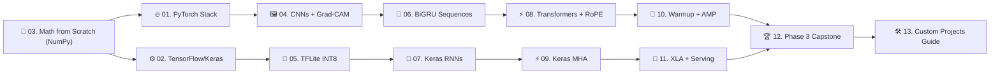

# 🧠 Phase 3: Deep Learning & Neural Networks

> **Duration**: 4–5 weeks · **Difficulty**: 🟠 Advanced · **Prerequisites**: Phases 1–2

This phase transitions from manual feature engineering to **representation learning**, teaching deep architectures side-by-side across **PyTorch** and **TensorFlow / Keras 3**, culminating in the **Transformer architecture**, **Rotary Position Embeddings (RoPE)**, and **INT8 Edge Quantization**.

---

## Learning Path

---

## Curriculum Overview

| # | Track | Domain | Key Topics | Notebook |
|:-:|-------|--------|------------|----------|
| 01 | PyTorch | Fundamentals | Tensors, Autograd, `nn.Module`, `DataLoader` | [`01-pytorch-fundamentals.ipynb`](../../notebooks/03-deep-learning/01-pytorch-fundamentals.ipynb) |
| 02 | TensorFlow | Fundamentals | `tf.GradientTape`, `@tf.function` XLA, Keras 3, `tf.data` | [`02-tensorflow-fundamentals.ipynb`](../../notebooks/03-deep-learning/02-tensorflow-fundamentals.ipynb) |
| 03 | NumPy | Math Foundations | Deep MLP from scratch, backprop verified vs. PyTorch & TF | [`03-neural-networks-from-scratch.ipynb`](../../notebooks/03-deep-learning/03-neural-networks-from-scratch.ipynb) |
| 04 | PyTorch | Computer Vision | Conv2D, ResNet transfer learning, Grad-CAM, ONNX | [`04-cnns-computer-vision-pytorch.ipynb`](../../notebooks/03-deep-learning/04-cnns-computer-vision-pytorch.ipynb) |
| 05 | TensorFlow | Vision & Edge | MobileNetV2, Depthwise Conv, `.tflite` & INT8 quantization | [`05-cnns-computer-vision-tensorflow.ipynb`](../../notebooks/03-deep-learning/05-cnns-computer-vision-tensorflow.ipynb) |
| 06 | PyTorch | Sequence Modeling | Vanishing gradients, `BiGRU`/`LSTM`, packed sequences | [`06-rnns-sequence-modeling-pytorch.ipynb`](../../notebooks/03-deep-learning/06-rnns-sequence-modeling-pytorch.ipynb) |
| 07 | TensorFlow | Sequence Modeling | Keras `LSTM`/`GRU`, sequence masking, bidirectional RNNs | [`07-rnns-sequence-modeling-tensorflow.ipynb`](../../notebooks/03-deep-learning/07-rnns-sequence-modeling-tensorflow.ipynb) |
| 08 | PyTorch | Transformers ⚡ | Scaled Dot-Product Attention, MHA, RoPE, Online Softmax | [`08-transformers-attention-pytorch.ipynb`](../../notebooks/03-deep-learning/08-transformers-attention-pytorch.ipynb) |
| 09 | TensorFlow | Transformers ⚡ | Keras `MultiHeadAttention`, Transformer blocks, embeddings | [`09-transformers-attention-tensorflow.ipynb`](../../notebooks/03-deep-learning/09-transformers-attention-tensorflow.ipynb) |
| 10 | PyTorch | Production | Cosine Warmup, AdamW, grad clipping, mixed precision, TorchServe | [`10-training-deployment-pytorch.ipynb`](../../notebooks/03-deep-learning/10-training-deployment-pytorch.ipynb) |
| 11 | TensorFlow | Production | XLA JIT, `CosineDecay`, SavedModel, TF Serving & TF.js | [`11-training-deployment-tensorflow.ipynb`](../../notebooks/03-deep-learning/11-training-deployment-tensorflow.ipynb) |

---

## Phase 3 Capstone & Custom Projects 🏆

- **Phase 3 End-to-End Capstone Project** — Build **OmniPulse**, a beginner-friendly Multimodal Industrial Sensor & Visual Defect Intelligence System unifying pure NumPy backpropagation vs. `torch.autograd`, Depthwise-Separable CNN + Grad-CAM, Bidirectional GRU vs. Pre-LN Transformer with RoPE & Online Softmax, AdamW + Warmup Cosine LR scheduling, Calibrated Affine INT8 Edge Quantization, and 3 multi-panel visual dashboards.
  📓 **Notebook**: [`12-phase-3-capstone-project.ipynb`](../../notebooks/03-deep-learning/12-phase-3-capstone-project.ipynb)
- **Phase 3 Custom Projects Guide** — 4 runnable custom Deep Learning blueprints (`VisionEdge-Inspector`, `ChronoPulse-Forecaster`, `NanoTransformer-Zero`, `Autograd-Verify`) with a 4-week sprint roadmap, starter repo layout, visual scorecards, and portfolio rubric.
  📓 **Notebook**: [`13-phase-3-custom-projects-guide.ipynb`](../../notebooks/03-deep-learning/13-phase-3-custom-projects-guide.ipynb)

---

## ✅ Completion Checklist

- [x] Implement a neural network from scratch (no `nn.Module`) and verify gradients against Autograd
- [x] Build a Depthwise-Separable CNN with Grad-CAM attribution and INT8 quantization
- [x] Implement Self-Attention with RoPE and Online Softmax from scratch in PyTorch
- [x] Compare RNN (`BiGRU`) vs. Transformer gradient dynamics across sequence time steps
- [x] Train a multimodal model with Warmup Cosine LR scheduling and gradient clipping

---

## Next Steps

[:material-arrow-left: ← Phase 2: ML Fundamentals](02-ml-fundamentals.md) · [:material-arrow-right: Phase 4: Generative AI →](04-generative-ai.md)
